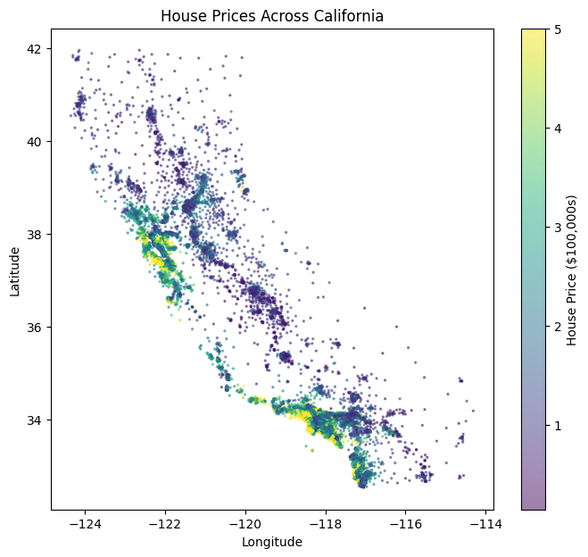
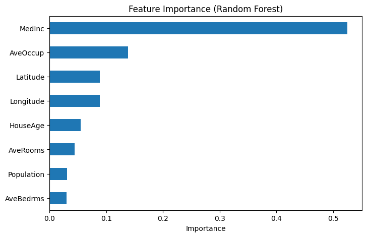
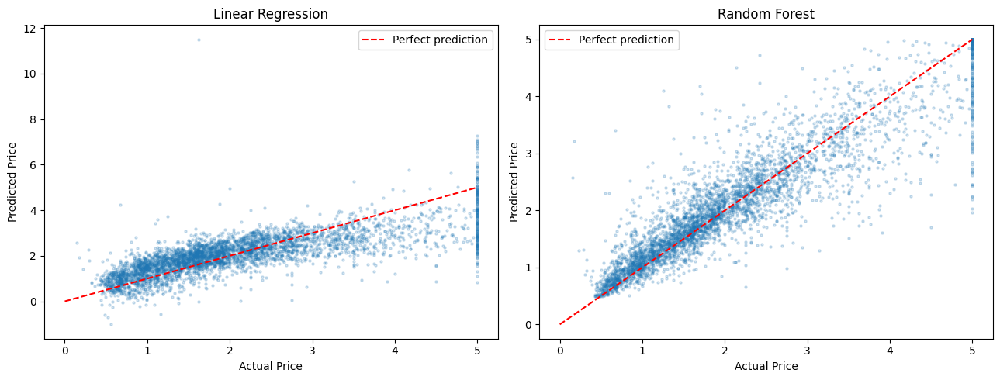

# 🏠 House Price Predictor

Predicting California house prices with machine learning, comparing **Linear Regression** with **Random Forest**.

## 📌 Problem
Given information about an area (income, house age, rooms, population, location), predict the **median house price**.

## 📊 Dataset
[California Housing dataset](https://scikit-learn.org/stable/datasets/real_world.html#california-housing-dataset) (built into scikit-learn)
- 20,640 rows, 8 features
- Target: median house value (in $100,000s, capped at $500k)

## 🛠️ Tools Used
Python · pandas · NumPy · matplotlib · seaborn · scikit-learn · Jupyter

## 🔍 Steps
1. Loaded and explored the data (checked types, missing values, statistics)
2. Visualized price distribution, feature correlations, and prices on a map
3. Split the data: 80% training, 20% testing
4. Trained **Linear Regression** (baseline) and **Random Forest**
5. Evaluated with MAE, RMSE and R²
6. Analyzed feature importance

## 📈 Results
| Model | MAE | RMSE | R² |
|---|---|---|---|
| Linear Regression | 0.533 (≈ $53,300) | 0.746 | 0.576 |
| **Random Forest** | **0.328 (≈ $32,800)** | **0.505** | **0.805** |

**Key findings:**
- **Random Forest beat Linear Regression**, with R² of 0.805 vs 0.576 and about 39% lower average error, because house prices follow non-linear patterns.
- **Median income** is the strongest predictor (importance ≈ 0.52).
- **Location** (latitude + longitude ≈ 0.18) is the next biggest factor, since coastal areas are much more expensive.
- **Average occupancy** ranked high (≈ 0.14) despite weak correlation, showing that the model captured non-linear effects.

| Prices across California | Feature importance |
|---|---|
|  |  |



## ⚠️ Limitations
- Prices are capped at $500,000, so the model can't predict very expensive houses well.
- Data is from the 1990 US Census, so prices don't reflect today's market.

## 🚀 Future Improvements
- Try XGBoost and hyperparameter tuning (GridSearchCV)
- Build a Streamlit web app for live predictions

## ▶️ How to Run
```bash
git clone https://github.com/Narinder123818/house-price-predictor.git
cd house-price-predictor
pip install -r requirements.txt
jupyter notebook house_price_predictor.ipynb
```
